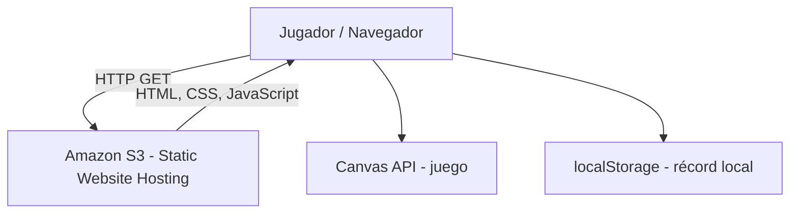

# Arquitectura

El navegador solicita los archivos estáticos directamente a Amazon S3. S3 entrega HTML, CSS, JavaScript y recursos del juego. El navegador ejecuta la lógica con Canvas API.

Amazon S3 es el único servicio AWS de la solución. Canvas API y localStorage son capacidades del navegador, no servicios AWS.
